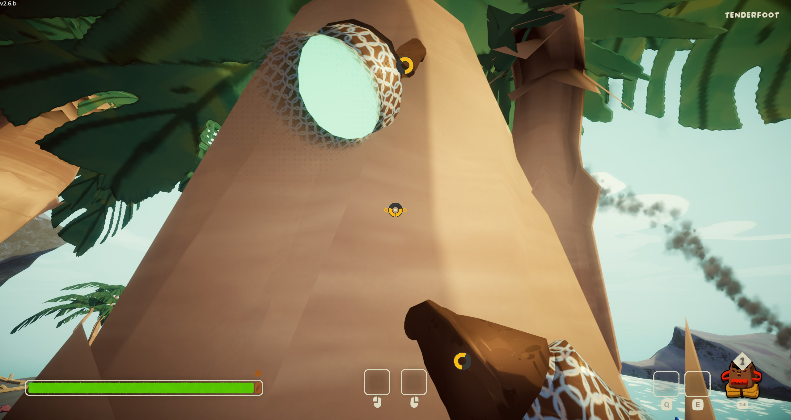
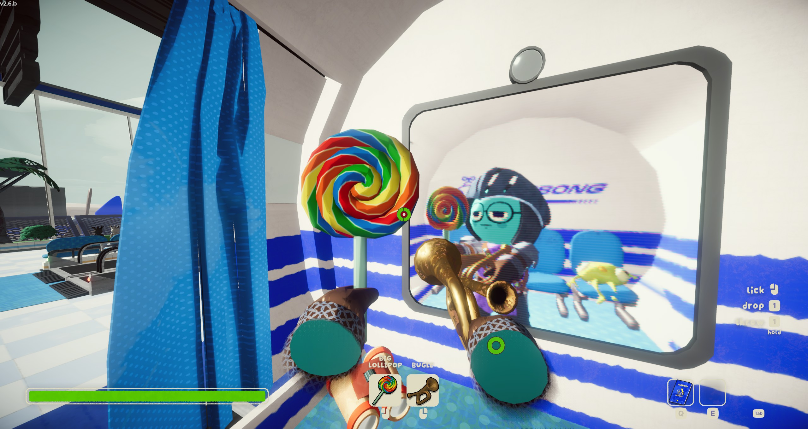

# Peakle

A [PEAK](https://store.steampowered.com/app/3527290/PEAK/) mod that makes climbing and the inventory work like
[White Knuckle](https://store.steampowered.com/app/3195790/White_Knuckle/): two independent hands, grip per hand,
hanging and swinging from holds, grab jumps, pockets and floating backpack slots.

**Download it from Thunderstore:** https://thunderstore.io/c/peak/p/SlopGaming/Peakle/




What it does and how to play is in the [Thunderstore README](package/README.md). Everyone in the lobby needs the mod.

## Building

You need the .NET SDK (6 or newer), Python 3, PEAK, and a Thunderstore Mod Manager (or r2modman) profile with
BepInEx installed.

1. Point the build at your files. Either edit the paths at the top of `src/Peakle/Peakle.csproj`, or create
   `src/Peakle/Peakle.user.props` (not committed):

   ```xml
   <Project>
     <PropertyGroup>
       <GameDir>C:\Program Files (x86)\Steam\steamapps\common\PEAK</GameDir>
       <ProfileDir>$(APPDATA)\Thunderstore Mod Manager\DataFolder\PEAK\profiles\Default</ProfileDir>
     </PropertyGroup>
   </Project>
   ```

   `GameDir` is used for PEAK's assemblies, `ProfileDir` for BepInEx and Harmony.
2. Build:

   ```
   cd src/Peakle
   dotnet build -c Release
   ```

   After each build the mod is installed into that profile as a local mod, so it shows in the manager's mod list.
3. Make the Thunderstore zip:

   ```
   python tools/pack_release.py src/Peakle/bin/Release/Peakle.dll package dist SlopGaming
   ```

The version comes from `Plugin.cs`; the deploy script copies it into `package/manifest.json`.

## Layout

| Path | What |
|---|---|
| `src/Peakle/` | The plugin. `PeakleHands.cs` holds hands, grabbing and the hanging physics; `WkBody.cs` is the White Knuckle player body; `Patches.cs` has the Harmony patches. |
| `package/` | Thunderstore manifest, README, changelog and icon. |
| `tools/` | Deploy-to-profile and packaging scripts. |
| `art/` | Source icon and menu logo. |

## Credits
- White Knuckle by Dark Machine Games, whose climbing this copies.
- PEAK by Aggro Crab and Landfall.
- [BepInEx](https://github.com/BepInEx/BepInEx), [Harmony](https://github.com/pardeike/Harmony) and
  [BepInEx.AssemblyPublicizer](https://github.com/BepInEx/BepInEx.AssemblyPublicizer).
- Code written with Claude Code (Anthropic's Claude). No AI-generated art or audio.

Not affiliated with Dark Machine Games, Aggro Crab or Landfall. This repository contains no game code or assets;
building it needs your own copy of PEAK.

## License
[MIT](LICENSE)
